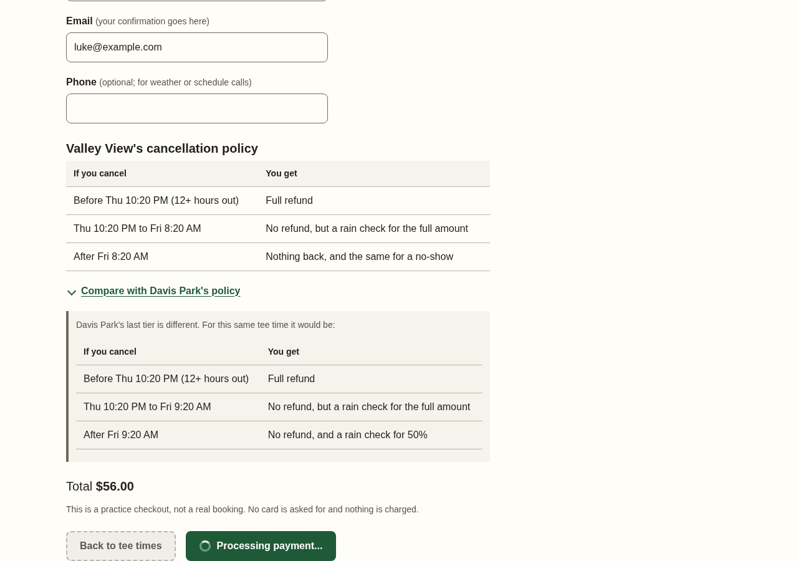
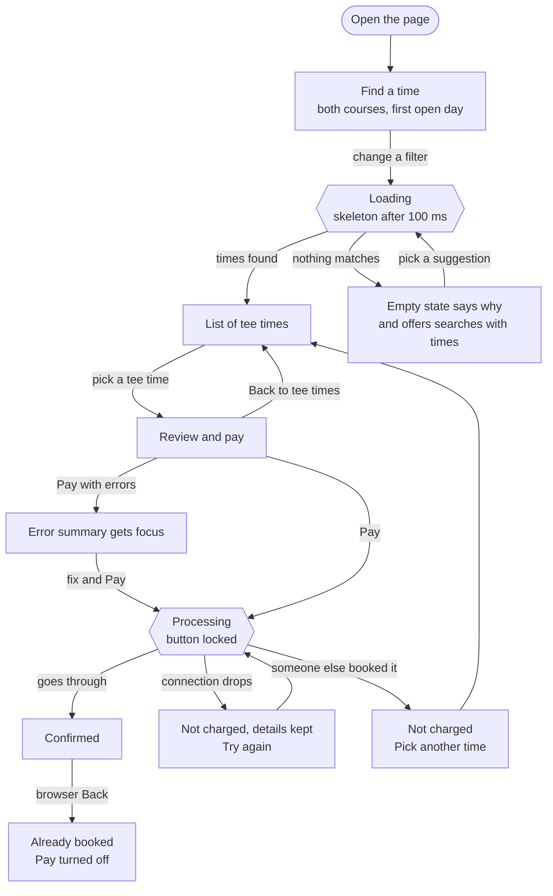

# Case Study 02: Interactive Prototype Specification

**Booking a Tee Time at Davis County's Two Public Golf Courses**

Luke Peterson · CS 3650 Human-Computer Interaction · Weber State University · November 2026

| | |
| --- | --- |
| Live prototype | [hqluke.github.io/3650-Case-Study-02](https://hqluke.github.io/3650-Case-Study-02/) |
| Every component in every state | [hqluke.github.io/3650-Case-Study-02/states.html](https://hqluke.github.io/3650-Case-Study-02/states.html) |
| Spec assets | [`prototype_spec/`](prototype_spec/) |

> [!NOTE]
> For my research project I audited ForeUp, the booking site Davis County uses for Davis Park and Valley View. This prototype is the booking flow rebuilt around what I found: both courses on one page, one control for 9 or 18 holes, empty results that say why, the cancellation policy right where you pay, and something you can actually use with a keyboard.

## Run it locally

The prototype is plain HTML, CSS, and JavaScript, so there is no build step. From the repo root:

```
python3 -m http.server 8765 --directory docs
```

Then open http://localhost:8765/ in a browser. The component states page is at http://localhost:8765/states.html.

## 1. Interaction Mechanics & Input Paradigm Mapping

### 1.1 The Flow

I picked the flow every golfer goes through. You find a time, review and pay, and get a confirmation. All three steps are on one page, and each has its own address so the browser's Back button works.

Each piece of the design comes from a Phase 1 finding:

| Phase 1 finding | ForeUp | Prototype |
| --- | --- | --- |
| H-01 (Severity 4) | The 9 / 18 / Both buttons only filter. The hidden booking class decides what loads, so the wrong combo shows nothing | One Holes control. The booking window rules are applied from holes and players |
| H-02 | Same empty message for sold out, not open yet, and wrong class | The empty state says which one and offers searches that have times |
| H-03 | Two separate sites | Both courses in one list, with a count and earliest time for each |
| H-04 | Days you can't book are a slightly lighter gray | Closed days are disabled and say when they open |
| H-05 | The cancellation policy is buried in the terms and differs by course | The policy is on the pay step with real deadlines for that tee time |
| H-06 | "Double check your DATE!!" | The day and time are on the Pay button |
| A-01, A-05 | Tee times can't be reached by keyboard, and focus jumps to the top after every choice | Real buttons and inputs, and focus stays put |

In Phase 1 I used the Keystroke-Level Model to estimate how long it takes an expert to find the earliest 9 hole time across both courses. On ForeUp's two sites it came out to 26.6 seconds. Here it's pick the date, pick 9 holes, and read the first card, which is 8.65 seconds.

### 1.2 Input Paradigms

Everything is a native HTML control, so the browser handles most of this on its own.

| Input | How the flow works with it |
| --- | --- |
| Touch | Tap a date, a tee time, and Pay. Nothing needs a swipe or pinch. On a phone the filters fold into one Filters button and Pay goes full width |
| Mouse | Every chip, card, and button changes on hover so you know it's clickable |
| Keyboard | Tab moves between groups and the arrow keys move inside one (dates, holes, players). Enter opens a tee time and submits the form. A skip link jumps past the header |
| Screen reader | Every group is a `<fieldset>` with a `<legend>`. The number of results, errors, and payment status are read out as they change |
| Voice control | Every control's name starts with what it says on screen, so "click 10:20 AM" or "click Pay" works |

### 1.3 Fitts' Law Target Sizing

Fitts' law says a target is harder to hit the farther away and the smaller it is (MacKenzie, 2024, Ch. 7). On a phone I can't do much about distance, so I made the things you hit most the biggest. Tee times and the Pay and Back buttons are the full width of the screen.

I measured every target with a script at phone width (390 px) and desktop width (1280 px). Everything is at least 44 x 44 px with 8 px between targets. The first run caught the links in the error summary at 32 px tall with no space between them, so I fixed those.

| Target | Smallest size on a phone | Smallest gap |
| --- | --- | --- |
| Tee time card | 358 x 110 | 8 |
| Pay and Back buttons | 358 x 48 | 16 |
| Date chip | 84 x 72 | 8 |
| Holes, players, time, and cart choices | 48 x 48 | 8 |
| Error summary links | 157 x 44 | 8 |

The full results are in [`target-size-audit.md`](prototype_spec/target-size-audit.md).

## 2. Prototype & Micro-Interaction Design

### 2.1 The Prototype

I built it in HTML, CSS, and JavaScript and put it on GitHub Pages. Becker (2020, Ch. 4) says a coded prototype is "attempting to understand how a product works in the real world," and I wanted the states to be real. A Figma file can show what focus looks like, but it can't show focus getting lost, and that happened in this build (Section 6.1).

The tee times are fake but act real. They're the same every time you load a day, the list ends 100 minutes before Layton's actual sunset, and the next day opens at 9:00 PM like the real courses. The "Prototype controls" at the bottom of the page can slow down the fake server or make the next payment fail, so every state can be tested.


*Figure 1. Find a time. Closed days say when they open, and one line compares both courses.*

### 2.2 Component State Matrix

The [component states page](https://hqluke.github.io/3650-Case-Study-02/states.html) shows each of these frozen. Screenshots are in [`prototype_spec/component-states/`](prototype_spec/component-states/).

| Component | Default | Hover | Focus | Active | Disabled | Loading | Error |
| --- | --- | --- | --- | --- | --- | --- | --- |
| Pay button | Green, label shows the total, day, and time | Darker green | Navy ring | Darkest green | Gray and dashed, with a notice saying why ("You already booked this tee time") | Spinner and "Processing payment...", extra clicks ignored | Alert says you weren't charged, button says "Try paying $56.00 again" |
| Back button | White with a green border | Light green | Navy ring | Pressed green | Off only while a payment is going | None | None |
| Choice chip | White, gray border | Light green | Navy ring | Pressed green | Gray and dashed, with a note ("Only 3 of 4 spots are open at this time.") | The results list shows it | Red border and a message under the group |
| Date chip | Day and date | Light green | Navy ring | Pressed green | Gray and dashed, says "Opens Sat 9 PM" | The results list shows it | None, closed days can't be picked |
| Course checkbox | Empty box | Light green | Navy ring | Pressed green | None | The results list shows it | Uncheck both and it says "Pick at least one course to see tee times." |
| Text field | White, gray border | Darker border | Navy ring | Same as focus | Not used, fields stay editable while paying | None | Red border, pink fill, a message that says how to fix it |
| Tee time card | Time, course, holes, spots, price | Green border and fill | Navy ring | Pressed green | Not used, taken times are left out | Gray skeleton cards | The empty state says why and offers other searches |
| Disclosure | Underlined link with an arrow | Thicker underline | Navy ring | Arrow turns and the panel opens | None | None | None |

Selected, disabled, and error states all have something besides color (a check mark, a dashed border, an icon), and hover never shows anything you need, since phone and keyboard users never see it.

### 2.3 Latency

MacKenzie (2024, Ch. 3) says 75 ms of lag raised pointing errors by 36%, so anything you click changes right away. Anything that waits on the server has to say so.

| Wait | What you see | What a screen reader hears |
| --- | --- | --- |
| Search under 100 ms | The new list, with no flash | The result count |
| Search over 100 ms | "Loading tee times for Saturday..." and gray skeleton cards | Nothing yet |
| Search over 1 s | Same | "Loading tee times..." |
| Paying | Spinner and "Processing payment...", Back turns off | "Processing your payment." |
| Payment fails | Red alert that says you weren't charged | The alert right away |



*Figure 2. Paying on a slow connection.*

## 3. Accessibility Architecture & WCAG Specification

### 3.1 Semantic HTML

Each step is a `<section>` inside one `<main>`, and only the current one is shown. The full markup is in [`docs/index.html`](docs/index.html).

```html
<a class="skip-link" href="#main">Skip to main content</a>
<header>...</header>
<nav aria-label="Booking steps">
  <ol><li aria-current="step">Find a time</li><li>Review and pay</li><li>Confirmed</li></ol>
</nav>
<main id="main">
  <section aria-labelledby="search-heading">
    <h1 id="search-heading" tabindex="-1">Find a tee time</h1>
    <form>
      <fieldset><legend>Date</legend> radio buttons </fieldset>
      <fieldset><legend>Holes</legend> radio buttons </fieldset>
      ...
    </form>
    <section aria-labelledby="results-heading">
      <h2 id="results-heading">Tee times</h2>
      <ul><li><button type="button">10:20 AM Valley View ...</button></li></ul>
    </section>
  </section>
  <section aria-labelledby="review-heading" hidden>
    <h1 id="review-heading" tabindex="-1">Review and pay</h1>
    <form>
      <fieldset><legend>Cart</legend> ... </fieldset>
      <label for="email">Email</label>
      <input id="email" type="email" autocomplete="email" aria-describedby="email-error">
      <p id="email-error" aria-live="polite"></p>
      ...
      <button type="submit">Pay $56.00 for Fri, Nov 6 at 10:20 AM</button>
    </form>
  </section>
  <section aria-labelledby="done-heading" hidden>...</section>
</main>
<footer>...</footer>
```

That fixes all five Level A failures from Phase 1: there's a `<main>`, headings, and a skip link, every control can be reached and has a name, and focus doesn't reset after each choice.

### 3.2 ARIA and Live Regions

I only added ARIA where the HTML didn't already say it. There's no `tabindex="0"` anywhere because every control is a real button or input, which are already in the Tab order. The only `tabindex` is `-1` on headings and the error summary, so focus can be moved there without adding a Tab stop.

| Attribute | Where | Why |
| --- | --- | --- |
| `aria-expanded` | Filters button on phones, "Compare with Valley View's policy" | Says if the panel is open |
| `aria-live="polite"` | Result count, field errors, total, payment status | Reads changes without interrupting |
| `role="alert"` | Payment failed, time was taken | Reads right away since you have to act on it |
| `aria-invalid="true"` | Fields with an error | Read as "invalid entry" with the message |
| `aria-describedby` | Fields to their errors, Holes and Players to their notes | Explains an error or a disabled option when you get to it |
| `aria-disabled="true"` | Pay button while paying | A real `disabled` would drop keyboard focus to the top of the page |
| `aria-current="step"` | Current step | The green circle only works if you can see it |

The annotated code for each of these is in [`code-snippets.md`](prototype_spec/code-snippets.md).

### 3.3 Contrast

All the colors are CSS variables, and a script reads them from the stylesheet and checks every pair. The lowest text is 5.83:1 and the lowest border is 5.31:1.

| Element | Colors | Ratio | Needs |
| --- | --- | --- | --- |
| Body text | `#22211e` on `#fffdf8` | 15.84:1 | 4.5:1 |
| Pay button and selected chips | `#ffffff` on `#1e5a37` | 8.16:1 | 4.5:1 |
| Hole badges | `#ffffff` on `#3a4a8c`, `#1e5a37`, `#54514a` | 7.92:1 and up | 4.5:1 |
| Error text | `#b42318` on `#fdeeed` | 5.83:1 | 4.5:1 |
| Control borders | `#6e6a5f` on `#fffdf8` | 5.31:1 | 3:1 |
| Focus ring | `#0b3d91` on `#fffdf8` | 9.88:1 | 3:1 |

The hole badge was 3.98:1 on ForeUp, and it's the only thing on a tee time that says 9 or 18 holes. All 16 pairs are in [`contrast-results.md`](prototype_spec/contrast-results.md).

axe found 0 violations on seven different page states ([`axe-results.md`](prototype_spec/axe-results.md)) and Lighthouse gave it 100 for accessibility. The raw report is in [`prototype_spec/lighthouse/report.html`](prototype_spec/lighthouse/report.html): accessibility 100, best practices 100, SEO 100. The only failed audit was cumulative layout shift 0.288 under Agentic Browsing, so the report is included as-is. I also tabbed through the whole flow and checked Chrome's accessibility tree, which is how I found the check mark on selected chips being read as part of the name. I haven't tested it with a real screen reader yet.

## 4. Interaction Flow

The Pay button's states have their own diagram in [`interaction-flow.md`](prototype_spec/interaction-flow.md).



## 5. Limitations

The tee times and prices are made up, and nothing is charged. The double payment check only works in one browser tab, since a real one would have to be on the course's server. I haven't tested it with a screen reader or with golfers yet, and it only has a light theme.

## 6. Post-Mortem Reflection

### 6.1 How did explicitly defining every component state (Hover, Focus, Active, Loading, Error) during the specification phase prevent dynamic usability bugs that static wireframes completely fail to address?

I think writing out every state made me think through the whole feature, and it made it hard to miss anything. A wireframe of the date picker is just seven boxes. The table made me decide what a day you can't book looks like, and whether it tells you why. ForeUp's doesn't, and that's how P1 decided next Friday was full when it just wasn't open yet. Mine says "Opens Sat 9 PM."

It also caught a bug in my own build. Focus was a row in the table, so the dates had to be tested with a keyboard, and after one arrow key press the focus disappeared. That's the same bug I found on ForeUp in Phase 1. A mockup would never show that because a picture can't lose focus.

The downside is time. Eight components with seven states each is a lot of boxes, and a lot of them ended up as "None." I also went straight to code. Becker (2020, Ch. 4) says "All prototypes should start as paper prototypes in some way," so I know the states work, but not whether golfers would actually like it.

### 6.2 Describe a scenario in your prototype where system latency or asynchronous data processing required specialized micro-interaction feedback. How does your design keep the user informed and prevent repeated submission errors?

Paying is the big one. Valley View's booking page says "Do not hit the back button or refresh during payment process. Double charge could happen." That's asking the golfer to work around the site. She et al. (2025) say that when users can't tell what happened, they "may conduct unnecessary and possibly erroneous operations," and clicking Pay a second time is exactly that.

In my prototype the Pay button switches to a spinner and "Processing payment..." as soon as you click it, Back turns off, and a screen reader hears "Processing your payment." Clicking again does nothing until it finishes. If the connection drops, it tells you that you weren't charged and keeps everything you typed. If you hit Back after paying, it says you already booked that time instead of letting you pay again.

The catch is that all of this is in the browser. A real double charge happens on the server, so the course's payment system would have to check for it too. My page can only make the second click do nothing.

## 7. GenAI Documentation

I used Claude to write the prototype code, the component states page, and the scripts that measure targets, check contrast, and take the screenshots, and it helped draft and edit this document. I picked the flow and the Phase 1 problems it had to fix, and went through the prototype on my phone and computer. The prompts, the code it generated, and the accessibility fixes made after testing are in [`AI_Log.txt`](AI_Log.txt).

## 8. References

Becker, C. R. (2020). *Learn human-computer interaction: Solve human problems and focus on rapid prototyping and validating solutions through user testing*. Packt Publishing.

Kirkpatrick, A., O Connor, J., Campbell, A., & Cooper, M. (Eds.). (2018). *Web content accessibility guidelines (WCAG) 2.1*. World Wide Web Consortium. https://www.w3.org/TR/WCAG21/

MacKenzie, I. S. (2024). *Human-computer interaction: An empirical research perspective* (2nd ed.). Morgan Kaufmann. https://doi.org/10.1016/C2022-0-02755-0

She, M., Yin, Z., & Li, Z. (2025). Human error. In C. Stephanidis & G. Salvendy (Eds.), *Foundations and fundamentals in human-computer interaction*. CRC Press. https://doi.org/10.1201/9781003495109-6
