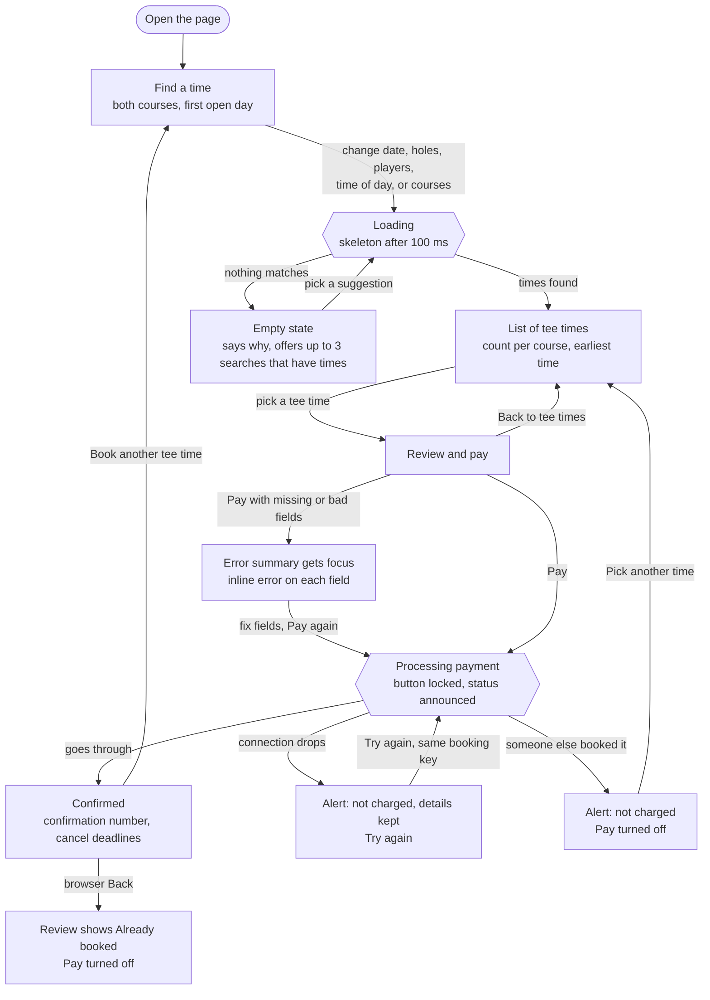
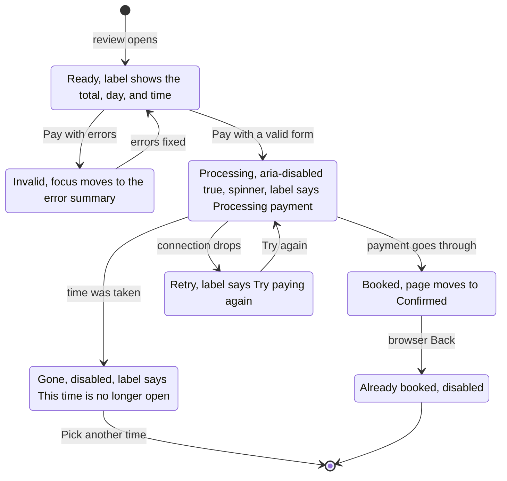

## Interaction Flow

GitHub draws these diagrams from the Mermaid code. The first one is the path through the three steps. The second is every state the Pay button can be in.

### Booking Flow

### Pay Button States

Two things don't change the state, so they aren't drawn as arrows. Changing holes, players, or cart while Ready only updates the total in the label. Clicking Pay again while Processing does nothing, because the submit handler returns early while a payment is out.
